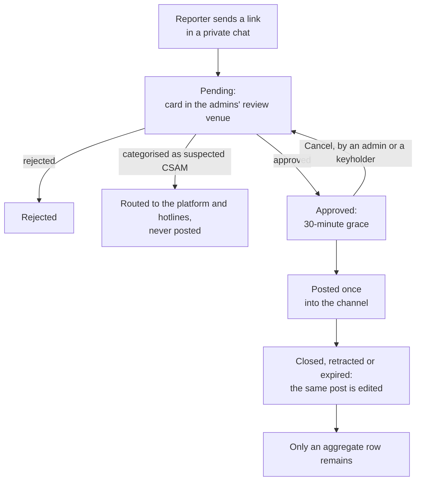

# DeeevBot (div-report)

[](https://github.com/souzangar/DeeevBot/actions/workflows/ci.yml)

A Telegram bot for reviewed, coordinated reporting of harmful social-media
accounts, run by an NGO working on network and security and on child and
family safety. The repository is named DeeevBot; the package, the database
and the docs call the project `div-report`.

Members send the bot a link to an account or a post that shares people's
private data, bullies or harasses someone, or harms a child. An admin
reviews every report. An approved one is posted once into a channel the
members join, with instructions for reporting it on the platform concerned
and the admin's suggested points, so that each member who chooses to can
file one genuine report in their own words.

The bot is designed for the case where its admins are arrested and their
accounts are used against the members. It therefore stores no member or
reporter identity, keeps no subscriber list, sends no direct-message
broadcasts, never sends a link outside an exact-host allowlist, and gives
a keyholder out of the admins' reach a lockdown switch and an emergency
wipe. The reasoning is in the
[threat model](doc/product/threat-model-seizure.md).

**Status:** the MVP's code is complete and tested; the bot is not live.
Go-live waits on the owner's checklist in the
[operations and security runbook](doc/guides/operations-and-security.md)
(section 9). Every push and pull request to `main` runs the build, the
tests and the invariant specs in [CI](.github/workflows/ci.yml).

## How a report moves



1. **Intake.** In a private chat, text only: the link, the account it
   belongs to when the link does not name it, one of seven categories,
   whether the reporter is the affected person, and an optional comment
   for the admins. Every message the reporter sends is deleted on receipt,
   and the one acknowledgement deletes itself. A second report of a target
   that is already open is merged into the first.
2. **Review.** The admins see a card in a private supergroup: an opaque
   reporter reference, the reported URL as non-tappable text, the category
   and the comment. An admin approves, rejects, or routes. Nothing skips
   review, and the bot never opens what is behind a link.
3. **Grace.** An approval starts a grace period, 30 minutes by default.
   Every keyholder receives the rendered post with a Cancel and a Lockdown
   button; an approval whose notice reaches no keyholder is never written.
4. **Post.** The report is posted once into the configured channel, with
   the platform's reporting instructions, link previews off, and an "I
   reported it" button that counts presses and records nobody.
5. **Closure.** "Taken down", "closed without result", a retraction with a
   correction, or expiry after 90 days: each one edits that same post.
   Then the report's links, comment and texts are deleted, and only an
   aggregate row (category, platform, day-level dates, outcome, counts)
   remains.

A report the admin categorises as suspected child sexual abuse material is
never posted. The admin gets a routing card for the platform's own report
channel and the hotlines, and the link never leaves the review venue.

The full state machine is in the
[report lifecycle](doc/product/report-lifecycle.md); the categories, what
each one's post may carry and the link policy are in
[report categories and routing](doc/product/report-categories-and-routing.md).

## Roles

| Role | Who | Can |
|---|---|---|
| Reporter | any user of the bot, known to it only by a keyed reference | submit reports, within rate limits that are wider for members of the NGO's group |
| Admin | a numeric Telegram id on the configured allowlist, never a username and never an administrator of the channel | approve, reject, route, close and retract, in the review venue only |
| Keyholder | a numeric id on a second allowlist, out of the admins' reach and never also an admin | own the channel and the accounts, receive every alert, cancel any approval during its grace, lock the bot down, run the emergency wipe |

Members receive posts by joining the channel and stop by leaving it.

## What must never happen

Eight invariants bind every change. In brief:

1. Nothing about a report reaches the channel without a recorded approval.
2. Admin authority is decided server-side, by numeric id, at every action,
   and only on updates that provably came from Telegram; under lockdown
   nothing is done at all.
3. A post exposes nobody: not the reporter, not their comment, not the
   approving admin.
4. Reported content is hostile data: never fetched, previewed, stored or
   re-hosted, and every link the bot sends is https and on an exact-host
   allowlist.
5. Posts go only to the configured channel; no list of members exists.
6. Secrets and report data stay out of code, version control, logs and
   telemetry.
7. Suspected child sexual abuse material is never re-broadcast.
8. No plaintext Telegram id of a reporter or member is ever stored, and a
   closed report leaves only counts behind.

The binding text is the "Critical invariants" section of
[CLAUDE.md](CLAUDE.md); each rule's reason and the test that pins it are in
[critical invariants](doc/architecture/critical-invariants.md). Every
stated "must not" has an always-run spec under `test/invariants/`.

## Stack

- **Cloudflare Workers, Free plan.** `src/worker.ts` answers Telegram's
  webhook and runs a one-minute cron that posts due reports, runs the
  edits, and by the minute reconciliation, retention and the monthly
  snapshot. D1 is the only store.
- **TypeScript** (strict, ESM), **grammY** for the Bot API, **zod** for
  the configuration.
- **A Node fallback port.** `src/node.ts` runs the same bot and the same
  tick with long polling, a minute loop and `node:sqlite`, straight from
  the TypeScript sources through Node's type stripping, in a container
  (`Dockerfile`, `docker-compose.yml`).
- **Persian and English** message catalogs (`src/i18n/`).

The decisions are the ADRs under [doc/architecture/](doc/architecture/index.md).

| Path | Holds |
|---|---|
| `src/telegram/` | bot wiring, handlers, the webhook secret check, long polling |
| `src/auth/` | the allowlist gate, lockdown, the membership check |
| `src/review/` | intake, the report state machine, categories and routing, approval, cancel |
| `src/broadcast/` | the single post, its edits, the jobs and the tick, finalization |
| `src/privacy/` | keyed references, the redacting logger, retention |
| `src/platforms/` | URL parsing, the link policy, per-platform instructions |
| `src/config/` | the configuration schema and loader |
| `src/db/`, `migrations/` | the SQL port with its D1 and `node:sqlite` adapters, the migrations |
| `src/errors/`, `src/i18n/` | the error catalog, the `fa` and `en` texts |
| `scripts/` | webhook registration, the emergency wipe, the docs gate |
| `test/` | the workers and invariants tiers, the fake Bot API, shared support |
| `doc/` | the documentation bundle |

## Getting started

Node 22.18 or later, npm, git, bash and jq.

```bash
npm ci                      # exactly what package-lock.json records
npm run build               # typecheck + lint
npm test                    # unit + workers tiers
npm run test:invariants     # the always-run "must never happen" specs
```

The tests need no Telegram token, no Cloudflare account and no network:
they run against a fake Bot API and a local D1.

To run the Worker locally:

```bash
cp .dev.vars.example .dev.vars   # fill in .dev.vars, never the example
npm run migrate:local            # apply migrations/ to the local D1
npm run dev                      # wrangler dev
```

| Command | What it does |
|---|---|
| `npm run typecheck` / `npm run lint` | `tsc --noEmit` / `eslint .` with type information |
| `npm run test:unit` | `*.test.ts` beside each module, plain Node |
| `npm run test:workers` | `test/workers/`, in the Workers runtime with a local D1 |
| `npm run dry-run` | bundle the Worker offline, without an account |
| `npm run port` | the Node fallback port from its sources |
| `docker compose up -d --build` | the port in its container |
| `npm run set-webhook -- <origin>` | register the webhook (the keyholder's operation) |
| `scripts/wipe.sh [--local]` | the emergency wipe; `--local` rehearses it |

The Node port deletes the webhook of the token it starts with, so it is
never started with the production token outside the fallback. The full
list of commands, the toolchain's settings and its known issues are in the
[developer setup](doc/guides/developer-setup.md).

## Configuration

Everything comes from environment variables, validated at load by
`src/config/schema.ts`. A configuration that breaks a rule starts nothing:
the Worker answers 500, the port refuses to start, and the one log line
names no variable and no value.

- **Bot:** `BOT_TOKEN`, `BOT_ID`, `BOT_USERNAME`
- **Webhook:** `WEBHOOK_SECRET`, `WEBHOOK_PATH_SEGMENT`
- **People:** `ADMIN_IDS`, `KEYHOLDER_IDS` (numeric ids, no id in both)
- **Chats:** `ADMIN_CHAT_ID` (the review venue), `MEMBERSHIP_CHAT_ID`,
  `BROADCAST_CHAT_ID` (the channel)
- **Privacy:** `REPORTER_REF_KEY`
- **Tunables:** `ALLOWED_LINK_HOSTS`, `APPROVAL_GRACE_MINUTES`,
  `VENUE_LOCALE`, `MARKS_PER_DAY`, `MARKS_PER_REPORT`, `LOCKDOWN`, and
  `SQLITE_PATH` for the Node port

What each one must hold, and how to generate the secrets, is in the
[developer setup](doc/guides/developer-setup.md) (section 6).
`.dev.vars.example` and `.env.example` are committed with every secret and
id empty; `.dev.vars` and `.env` are gitignored. `wrangler.jsonc` carries
a placeholder `database_id` and no value of any deployment.

## Deployment and operation

There is no one-command deploy, on purpose: who holds the Cloudflare
account, the BotFather account, the channel and the secrets is part of the
design.

- [Operations and security runbook](doc/guides/operations-and-security.md):
  the roots of trust, deployment on Workers, webhook registration, daily
  operation, lockdown, incident procedures and the go-live checklist.
- [Admin review runbook](doc/guides/admin-review-runbook.md): how an admin
  reviews, decides, routes, closes and retracts.
- [Fallback drill](doc/guides/fallback-drill.md): running the Node port on
  a host, switching back to the Worker, and the yearly drill.

## Tests

| Tier | Files | Runs in |
|---|---|---|
| unit | `src/**/*.test.ts`, `scripts/**/*.test.ts` | plain Node; no network, mocks at the boundary |
| workers | `test/workers/*.test.ts` | the Workers runtime with a local D1 binding |
| invariants | `test/invariants/*.test.ts` | plain Node; one spec per stated "must not" |

Every new logic file gets a unit test, and every stated "must not" a
regression test in the same change. Fixture values are never
secret-shaped, because the secret-shape scan reads test files too.

## Documentation

`doc/` is an Open Knowledge Format bundle; start at
[doc/index.md](doc/index.md).

- [product/](doc/product/index.md): the brief, the lifecycle, the
  categories, the threat model, retention, consent.
- [architecture/](doc/architecture/index.md): the ADRs and the invariants.
- [guides/](doc/guides/index.md): the runbooks and the developer setup.
- [reference/](doc/reference/index.md): per-platform reporting
  instructions, hotlines, Telegram Bot API and Cloudflare notes.
- [audits/](doc/audits/index.md): dated reviews and security audits.

After adding, moving or retitling a doc, run
`node scripts/okf/build-index.mjs`; `node scripts/okf/check.mjs` is the
docs gate.

## Working on the code

- [CLAUDE.md](CLAUDE.md) is the single source of truth for conventions:
  commands, architecture, the invariants, error handling, testing and
  commit style. [AGENTS.md](AGENTS.md) is its thin mirror for other
  coding agents.
- Commits follow Conventional Commits, the scope being the changed module:
  `feat(review): ...`, `fix(broadcast): ...`.
- CI (`.github/workflows/ci.yml`) runs the commit gate's three steps
  (build, tests, invariants) and the offline bundles of the Worker and the
  probe on every push and pull request to `main`, on Node 22. It uses no
  secret, no Cloudflare account and no Telegram token, and must stay that
  way. `.github/workflows/codeql.yml` runs GitHub's CodeQL analysis.
- `.claude/`, `selftest/` and `selftest-okf/` hold the Claude Code hooks,
  agents and their self-tests. The commit gate there runs only for commits
  made through Claude Code. A commit typed in a terminal runs no hook, so
  run the same steps by hand before pushing:

  ```bash
  npm run build && npm test
  .claude/hooks/rules-sync-check.sh && .claude/hooks/secret-shape-scan.sh
  bash selftest/run-all.sh && bash selftest-okf/run-all.sh
  node scripts/okf/check.mjs && npm run test:invariants
  ```

- Files on a critical path carry a `// @critical-path` comment near the
  top; a change to one is checked against the eight invariants before it
  is committed.

## Security

- Never put a bot token, a webhook secret, a Telegram id, a chat id or a
  reported URL in an issue, a pull request, a commit or a log.
- Report a weakness privately to the repository's owner (GitHub's "Report
  a vulnerability" under the Security tab, where it is enabled), not in a
  public issue.
- What the design defends against, and what it states as outside its
  control, is in the [threat model](doc/product/threat-model-seizure.md).

## Licence

Public domain, under [The Unlicense](LICENSE): anyone may copy, modify,
publish, use, sell or distribute this software, for any purpose, without
warranty of any kind.
